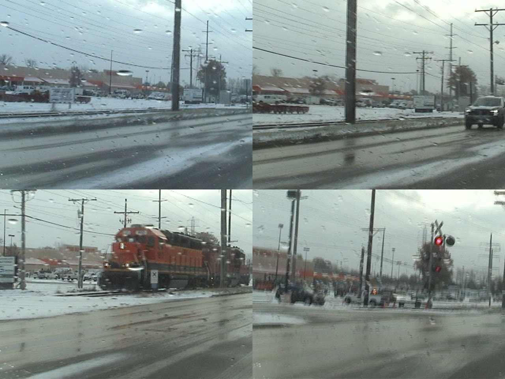
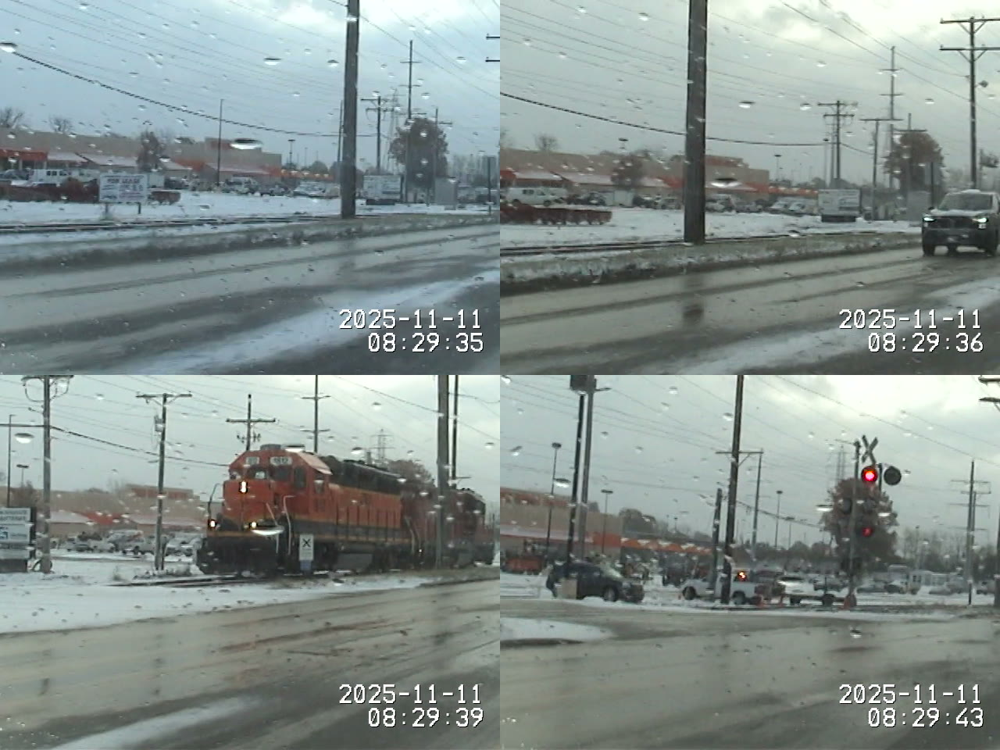
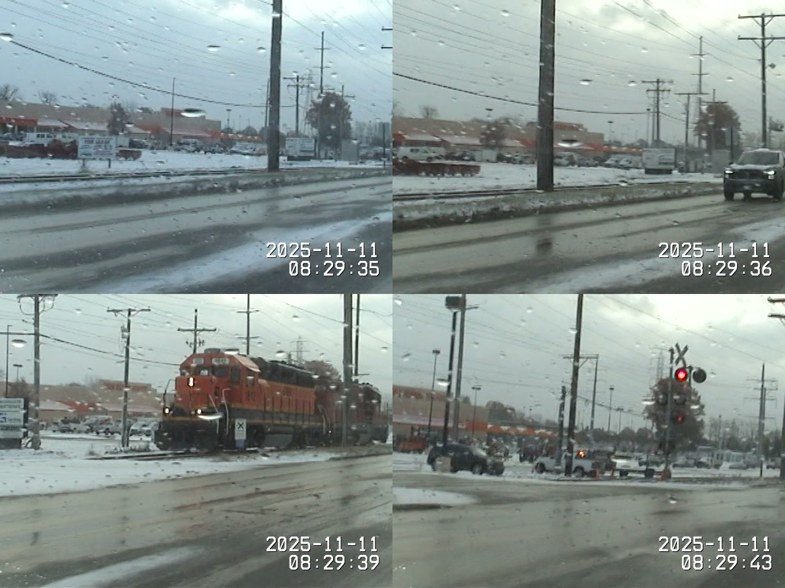

# Train DV preservation demonstration

[Download the example release](https://github.com/shardsofaperture/DVMetaDataBurnIn/releases/tag/examples-train-dv-v1) · [manifest](train-dv/manifest.json) · [SHA-256 checksums](train-dv/SHA256SUMS-v2.txt) · [measurements](train-dv/measurements.json)

This is one complete, approximately eight-second train clip supplied by **Zach Zarzycki (ThePolish / shardsofaperture)**, not an excerpt made for this release. The supplied files were identified by their contents, frame counts, streams, embedded dates, and matching scenes, then hashed before work. Their local filenames were `Train Raw DV Capture.avi` and `Train Dateburn Transcoded.mp4`; neither was renamed or overwritten in place.

The owner's actual workflow was:

**Sony MiniDV camcorder → Sony laptop capture → flash drive → Mac → DVMetaDataBurnIn → processed outputs.**

The raw capture is DV compressed video inside an AVI container, not uncompressed video. The supplied MP4 is an existing viewing copy. Its exact app version, commit, encoding settings, and deinterlacing method are **unknown**; its encoder tags alone do not establish provenance. Four additional derivatives were generated on November 13, 2026 through the unchanged 1.0.7 maintenance CLI at [`5f7e13e0b9f94b98bfef32c5d828aae614265583`](https://github.com/shardsofaperture/DVMetaDataBurnIn/commit/5f7e13e0b9f94b98bfef32c5d828aae614265583). They are identified separately below.

## Files and direct downloads

| Asset | Role | Bytes | Relationship |
| --- | --- | ---: | --- |
| [train-01-original-dv.avi](https://github.com/shardsofaperture/DVMetaDataBurnIn/releases/download/examples-train-dv-v1/train-01-original-dv.avi) | Original supplied Sony DV AVI capture | 30,105,600 | original |
| [train-01-owner-dateburn.mp4](https://github.com/shardsofaperture/DVMetaDataBurnIn/releases/download/examples-train-dv-v1/train-01-owner-dateburn.mp4) | Owner-supplied timestamp-burned viewing copy | 3,319,029 | transcode |
| [train-01-maintenance-burn-60p.mp4](https://github.com/shardsofaperture/DVMetaDataBurnIn/releases/download/examples-train-dv-v1/train-01-maintenance-burn-60p.mp4) | New maintenance 60000/1001 fps yadif viewing copy | 7,360,608 | transcode |
| [train-01-maintenance-burn-deinterlace-off.mp4](https://github.com/shardsofaperture/DVMetaDataBurnIn/releases/download/examples-train-dv-v1/train-01-maintenance-burn-deinterlace-off.mp4) | New maintenance burn-in with deinterlacing off; combing retained, progressive H.264 flag | 8,223,526 | transcode |
| [train-01-maintenance-dv-copy.mov](https://github.com/shardsofaperture/DVMetaDataBurnIn/releases/download/examples-train-dv-v1/train-01-maintenance-dv-copy.mov) | New maintenance DV stream-copy derivative | 30,090,518 | remux |
| [train-01-maintenance-subtitles.mkv](https://github.com/shardsofaperture/DVMetaDataBurnIn/releases/download/examples-train-dv-v1/train-01-maintenance-subtitles.mkv) | New maintenance H.264/AAC MKV with switchable ASS and attached font | 8,338,107 | transcode |
| [train-01-maintenance-timestamps.ass](https://github.com/shardsofaperture/DVMetaDataBurnIn/releases/download/examples-train-dv-v1/train-01-maintenance-timestamps.ass) | Standalone ASS generated before MKV mux; source timeline starts at zero | 1,172 | subtitle export |

All derivatives map to `train-01-original-dv`. Distinct file hashes were retained; no identical video files needed deduplication. Original capture SHA-256:

```text
13be6af4cc481e5eea0a8ed9daee8d9ef329abd79ccc5c6620147604cefcca0a
```

All media fit the [GitHub release limit of less than 2 GiB per asset](https://docs.github.com/en/repositories/releasing-projects-on-github/about-releases), checked November 13, 2026. No multipart packaging or recompression for upload was needed. Media are release assets, not ordinary Git blobs. The example release is explicitly excluded from “Latest”; `1.0.6beta` remains the current application release.

## Genuine before/after frames

Each 2×2 sheet is ordered left to right, top to bottom: beginning, first timestamp transition, middle, final frame. Source and 29.97-rate outputs use zero-based frames **0, 24, 119, 237**, at approximately **0, 0.800801, 3.970637, 7.907908 seconds** by their container rate. The 60p sheet uses **0, 48, 238, 475**; its last frame is the second field-derived frame associated with source frame 237, at approximately 7.924583 seconds.

Preview processing is only `scale=640:480,setsar=1,tile=2x2` and JPEG encoding (`-q:v 3`), applied equally to each selected decoded frame. It converts 720×480 with 8:9 sample aspect ratio to square-pixel 4:3. **No preview deinterlacing, added timestamp, or simulated UI** is used. JPEG previews are not pixel-identity evidence.

Original capture:



Owner-supplied timestamped MP4:



New maintenance burn-in, deinterlacing off:


New maintenance 60p (`yadif=mode=1`):



The sampled scenes establish the source/output relationship. Still-frame inspection confirms visible timestamp text at these positions. It does not establish smooth motion, correct deinterlacing cadence, subjective audio quality, or all-player compatibility.

## Measured stream and integrity results

Measurements use bundled **FFmpeg 8.0.1-tessus**, bundled **DVRescue 24.07 / MediaInfoLib 24.06**, and an already installed **ffprobe 9.0.2** on Intel macOS. ffprobe is an optional developer tool; it is not assumed to be bundled. Full machine-readable stream properties, packet timing, decoded field flags, payload/audio hashes, and tool versions are in [measurements.json](train-dv/measurements.json).

| Sample | Video / audio | Frames | Video rate | Video duration | Fields / subtitles |
| --- | --- | ---: | --- | --- | --- |
| Original AVI | DV `yuv411p` / PCM s16le | 238 | `2997/100` container | 7.941275 s | All 238 decoded frames interlaced, bottom field first; no subtitles |
| Owner MP4 | H.264 `yuv422p` / AAC | 238 | `2997/100` | 7.941275 s | Flagged progressive; permanent overlay; deinterlace settings unknown |
| Maintenance MOV | DV `yuv411p` / PCM s16le | 238 | `2997/100` | 7.941275 s | All 238 decoded frames interlaced, bottom field first; no subtitles |
| Maintenance deinterlace-off MP4 | H.264 `yuv422p` / AAC | 238 | `2997/100` | 7.941275 s | Visible combing retained but flagged progressive; permanent overlay |
| Maintenance 60p MP4 | H.264 `yuv422p` / AAC | 476 | `60000/1001` | 7.941267 s | Flagged progressive; permanent overlay |
| Maintenance MKV | H.264 `yuv422p` / AAC | 238 | `2997/100` | Packet span 0–7.941 s | Container `bt`, decoded H.264 frames progressive; 9 switchable ASS events |

Every video is 720×480, sample aspect ratio 8:9, display aspect ratio 4:3; audio is 48 kHz, two channels (the AVI does not declare a channel-layout tag; FFmpeg interprets it as stereo). Original and MOV PCM contain 381,180 samples per channel (7.941250 s). MP4 AAC reports 7.941000 s stream duration; decoded s16le output contains 381,952 samples per channel (7.957333 s). The MKV container reports 7.962 s, its ffprobe audio packet span includes encoder priming from −0.021 to 7.957 s, and bundled FFmpeg's decoded s16le output contains 382,976 samples per channel (7.978667 s). Padding/priming and demuxer handling differ; these are not claims of audio identity or verified lip sync for the AAC copies. The supplied and newly generated MP4s happen to have matching decoded-audio hashes, but those hashes differ from the original PCM. Listening acceptance remains open.

The AVI header reports **2997/100**, while DVRescue reports the DV signal's nominal **30000/1001**. For 238 frames those imply 7.9412746 versus 7.9412667 seconds, a difference of about 8 microseconds. The maintenance timestamp parser restores the nominal NTSC rate. The 29.97-rate output containers retain the supplied AVI's rational rate, while the 60p path explicitly uses 60000/1001. Neither is silently relabeled.

Full audio/video decoding of all six files returned success with no FFmpeg error-level messages. This is a bounded decode check, not evidence that the tape has no concealed damage.

For AVI versus MOV, the verifier demuxes the selected encoded DV video stream with `-map 0:v:0 -c:v copy -f data -` and hashes the **concatenated payload bytes**, independent of packet boundaries. Both contain **28,560,000 bytes**, SHA-256 `9d1e44eaccd9d4a0e318009c2b8a8bb2b70962f109d77b561a358bc0dff7254c`. Separately, native-rate/channel decoded PCM s16le is **1,524,720 bytes**, SHA-256 `7361915b0c317d46f4e3d4d8110255c74d175f6ca2704f0ac80661ada01ba065`, for both. DVRescue extraction also returns the same 238 recording-date rows and transitions for AVI and MOV. Whole-file hashes differ, as expected. These checks do **not** establish preservation of every AVI/container metadata field or correct playback in every player. Retain the AVI reference.

## Recording dates, transitions, and subtitle coverage

[DVRescue XML](train-dv/source-dvrescue.xml) and the [238 per-frame metadata rows](train-dv/source-recording-metadata.txt) identify recording dates from **2025-11-11 08:29:35** through **08:29:43**. Timecode is separately **00:02:41;06** through **00:02:49;03**. A recording date is the camera's stored calendar clock; timecode identifies positions in the recorded stream. Filesystem modification dates and container presentation timestamps describe other events/timelines and are not substitutes for that camera clock.

There is no independent confirmation that the camera clock was historically correct. These results demonstrate **extraction/rendering consistency**, not independently verified recording-date truth. The source XML flags `rec_start` at frame 0. No interior recording-date reversal, skipped second, date change, or stop/start discontinuity was observed in these 238 rows. This short clip does not test midnight rollover or damaged-tape recovery.

The extracted second changes occur at zero-based frames **24, 54, 84, 114, 144, 174, 204, 234**. Visual inspection of each before/after transition and the first/final frame found matching dates and seconds in the supplied MP4, maintenance deinterlace-off MP4, and maintenance 60p MP4. Transition sheets are [owner](train-dv/owner-transitions.png), [maintenance off](train-dv/maintenance-deinterlace-off-transitions.png), and [maintenance 60p](train-dv/maintenance-60p-transitions.png). Each sheet is ordered row-major: first frame, the two frames surrounding each change, final frame. For 60p the sampled pair is `2*n-1, 2*n` at each source transition `n`; otherwise it is `n-1, n`. These sheets crop `300:120:420:360` without scaling or additional deinterlacing.

The standalone [ASS](train-dv/train-01-maintenance-timestamps.ass) is the app-generated pre-mux subtitle artifact. Events are [0,0.8), [0.8,1.8), …, [6.8,7.8), [7.8,7.95) seconds. ffprobe reads the same nine intervals in the MKV: positive duration, no overlap/gap, and coverage past the last video's packet end at approximately 7.941 s. ASS centisecond boundaries precede nominal source changes by approximately 0.8–7.8 ms, below one source frame. Text agrees with the extracted second values. The MKV includes an attached font and switchable ASS; the video pixels are not permanently timestamped. Actual subtitle rendering/toggling in target players remains unverified. Re-exporting ASS through another muxer may shift timestamps to account for audio priming; the published ASS is the original app artifact, not such a re-export.

## Reproduce measurements and processing

Download the desired assets into a new directory and compare them against [SHA256SUMS-v2.txt](train-dv/SHA256SUMS-v2.txt). The v2 checksum file covers every named release asset except itself, including `manifest.json`, `verification.json`, both sample-note revisions, and the original checksum file. [SAMPLE-NOTES-v2.txt](train-dv/SAMPLE-NOTES-v2.txt) corrects the documentation link after GitHub reported that `main` is locked; original published bytes are retained. [PR #192](https://github.com/shardsofaperture/DVMetaDataBurnIn/pull/192) tracks the focused documentation/licensing integration. The versioned release notes preserve the original publication status; they are historical records, not the current branch status. The manifest lists video/subtitle samples; the checksum file also covers the supporting release documents. No circular checksum is required.

From a checkout containing the verifier, use existing installed tools with explicit paths. It does not modify inputs, download files, or run as part of the default test suite:

```sh
python3 scripts/verify_train_demo.py --ffmpeg "$PWD/Resources/bin/ffmpeg" --ffprobe /path/to/ffprobe --dvrescue "$PWD/Resources/bin/dvrescue" --manifest docs/examples/train-dv/manifest.json --reference /path/to/train-01-original-dv.avi /path/to/train-01-original-dv.avi /path/to/train-01-maintenance-dv-copy.mov /path/to/train-01-owner-dateburn.mp4 /path/to/train-01-maintenance-burn-deinterlace-off.mp4 /path/to/train-01-maintenance-burn-60p.mp4 /path/to/train-01-maintenance-subtitles.mkv > train-measurements.json
```

A nonzero exit reports a missing tool/input, failed probe/decode, manifest mismatch, failed reference payload/audio comparison, or invalid subtitle coverage. Reference identity is checked only for DV outputs; H.264 transcodes are not expected to match DV payloads. Read all reported limitations and properties, not only the exit status.

To regenerate the four maintenance outputs, use a separate checkout of tag `v1.0.7-maintenance.1`, the hash-verified original, and a new empty work directory. [processing-commands.json](train-dv/processing-commands.json) contains the exact argument arrays used, with private paths replaced by `${APP_REPO}`, `${SOURCE}`, and `${WORK}`. Expand those placeholders as literal path prefixes, not with shell `eval`. The following Python example runs those arrays safely and refuses an existing work directory:

```python
import hashlib, json, pathlib, subprocess
app = pathlib.Path('/path/to/checkout-at-v1.0.7-maintenance.1').resolve()
source = pathlib.Path('/path/to/train-01-original-dv.avi').resolve()
work = pathlib.Path('/path/to/new-work-directory').resolve()
commands = json.loads(pathlib.Path('docs/examples/train-dv/processing-commands.json').read_text())
assert subprocess.check_output(['git', '-C', str(app), 'rev-parse', 'HEAD'], text=True).strip() == commands['application_commit']
assert not subprocess.check_output(['git', '-C', str(app), 'status', '--porcelain', '--', 'Resources'], text=True).strip()
expected = '13be6af4cc481e5eea0a8ed9daee8d9ef329abd79ccc5c6620147604cefcca0a'
assert hashlib.sha256(source.read_bytes()).hexdigest() == expected
work.mkdir(exist_ok=False)
replacements = {'${APP_REPO}': str(app), '${SOURCE}': str(source), '${WORK}': str(work)}
for index, template in enumerate(commands['argv']):
    argv = []
    for arg in template:
        for key, value in replacements.items():
            arg = arg.replace(key, value)
        argv.append(arg)
    with (work / f'processing-{index}.log').open('w') as log:
        subprocess.run(argv, stdout=log, stderr=subprocess.STDOUT, check=True)
assert hashlib.sha256(source.read_bytes()).hexdigest() == expected
```

Commands use single-file mode, stacked layout, high quality, UAV OSD Sans Mono, explicit bundled tools, a separate destination, and retained scratch artifacts. H.264 settings resolve to libx264 CRF 18/preset slow and AAC 192 kb/s. The MOV uses stream copy; the 60p burn-in adds `yadif=mode=1` and `-r 60000/1001`; the subtitle run uses `subtitleTrack`/`per-clip`. Output names produced by the app are mapped to descriptive public names in the command JSON; sources are untouched. Re-encoding can produce different container bytes across environments, so verify properties and provenance rather than promising byte-identical new transcodes.

To regenerate a comparison sheet from a downloaded 29.97-rate file:

```sh
Resources/bin/ffmpeg -v error -i /path/to/train-01-owner-dateburn.mp4 -vf 'select=eq(n\,0)+eq(n\,24)+eq(n\,119)+eq(n\,237),scale=640:480,setsar=1,tile=2x2' -frames:v 1 -q:v 3 /path/to/new-comparison.jpg
```

## Evidence boundaries and rights

**Real footage:** current hashes, full decodes, streams, fields, payload/PCM identity for the MOV, recording-date extraction, subtitle packet coverage, and sampled visible overlays. Public downloads are verified from unauthenticated downloaded bytes; [the publication receipt](train-dv/public-download-verification.json) records all 13 matching sizes and hashes and confirms `1.0.6beta` remains Latest.

**Historical synthetic/build evidence:** November 12, 2026 maintenance implementation `fac8e6f` and preview commit `5f7e13e`. The retained preview logs substantiate 26 synthetic regressions plus three shell smoke checks and a Release build at `5f7e13e`. Six Swift workspace checks and native Debug/Release builds belong to the earlier maintenance validation that day; they were not rerun for this documentation task. See the [maintenance report](https://github.com/shardsofaperture/DVMetaDataBurnIn/blob/maintenance/1.0.7/docs/MAINTENANCE_1.0.7.md). Synthetic edge cases do not establish real camera/GUI acceptance.

**Independent recording facts:** the owner supplied the capture workflow and identified the demonstration files. No independent recording-clock ground truth is available. Other cameras, long recordings, midnight/day transitions, damaged tapes, GUI behavior, motion/audio quality, and Apple Silicon remain outside this demonstration's acceptance.

Attribution: **Zach Zarzycki (ThePolish / shardsofaperture)**. Published with owner authorization. No new media license is granted for these videos or extracted frames; the application MIT license applies separately. [Licensing and third-party notices](../LICENSING.md) explain the distinction.
