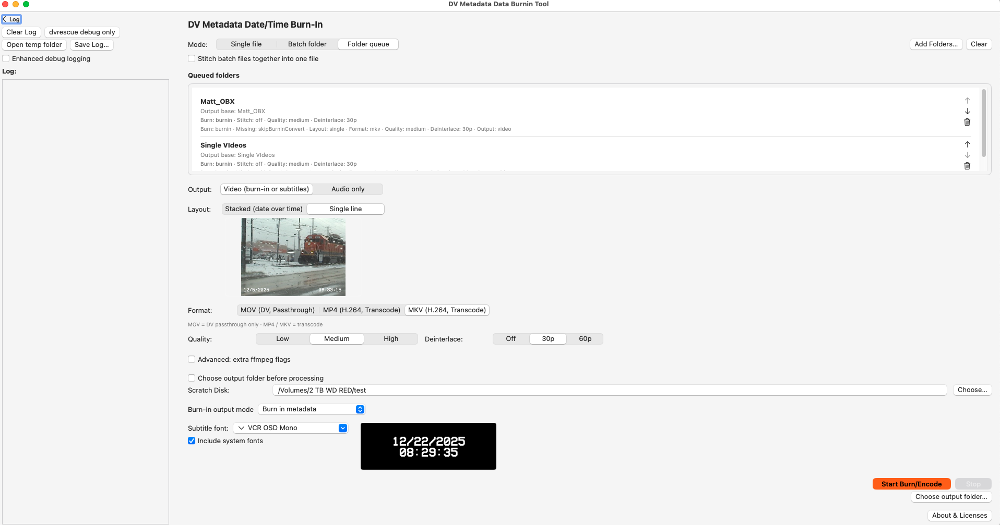

# DVMetaDataBurnIn

A free, open-source macOS application for preserving the recording context of legacy DV and Digital8 video. It brings DV recording-date extraction, timestamp presentation, batch processing, and verification into one workflow using **DVRescue** and **FFmpeg**.

> I created this because I could not find a suitable free, open-source macOS workflow for recovering and displaying my original camcorder recording dates without assembling command-line tools myself. — Zach Zarzycki (ThePolish)

**[Recommended established release: v1.0.6 (published as beta)](https://github.com/shardsofaperture/DVMetaDataBurnIn/releases/tag/1.0.6beta)** · **[Train demonstration: original and processed videos](docs/examples/TRAIN_DV_PRESERVATION.md)** · **[Preservation roadmap](docs/ROADMAP.md)**

**Active experimental development:** [`maintenance/1.0.7`](https://github.com/shardsofaperture/DVMetaDataBurnIn/tree/maintenance/1.0.7) · [Preview 2 download and corresponding source](https://github.com/shardsofaperture/DVMetaDataBurnIn/releases/tag/v1.0.7-maintenance.2) · [tests and known limitations](https://github.com/shardsofaperture/DVMetaDataBurnIn/blob/maintenance/1.0.7/docs/MAINTENANCE_1.0.7.md). Preview 2 includes the output-safety and field-signaling fixes, traceable source-built tools, and OFL fonts. Stable application source remains [v1.0.6 on main](https://github.com/shardsofaperture/DVMetaDataBurnIn/tree/main).

The train demonstration includes the complete supplied DV AVI, the owner's timestamped MP4, and separately identified maintenance-generated comparisons. Downloadable hashes, measured stream properties, genuine before/after frames, and reproduction commands make the results inspectable.

## What it does

- Processes existing DV AVI files individually or in batches, with a folder queue.
- Extracts embedded camcorder recording date/time through DVRescue.
- Burns date/time into viewing copies or creates an MKV with switchable ASS subtitles.
- Offers DV stream-copy MOV derivatives, H.264 viewing copies, and deinterlacing settings.
- Provides a macOS interface around the processing tools, which are bundled with the app.

Keep the original capture as the reference. A DV-copy MOV is a derivative; it is not automatically a verified preservation master. A timestamp overlay makes selected information visible but does not preserve every original metadata field. MP4 and H.264 MKV exports are lossy viewing copies. See the [measured distinctions and limitations](docs/examples/TRAIN_DV_PRESERVATION.md).

Direct tape capture is **planned**, not available in this application. DV/Digital8 and later HDV capture have separate hardware, software, and acceptance prerequisites in the roadmap.

## Platform and maintenance status

The stable 1.0.6 package contains an **Intel/Apple Silicon app executable**, but bundled FFmpeg and DVRescue are **Intel-only**. The 1.0.7 preview package is Intel-only throughout. The project/package minimum is macOS 12; native build evidence is Intel macOS 14 with Xcode 15.4. Apple Silicon operation and translation of the bundled tools remain unvalidated; an arm64 app slice alone does not establish compatibility.

The separate [1.0.7 maintenance preview](https://github.com/shardsofaperture/DVMetaDataBurnIn/releases/tag/v1.0.7-maintenance.2) improves subtitle-tail timing, temporary workspace isolation, batch error handling, and cancellation cleanup. **This is the unconfirmed maintenance branch.** Its 1.0.7 application changes remain here for owner testing; `main` retains the stable 1.0.6 application code plus the shared documentation, licensing, videos, and roadmap. No maintenance code is approved for stable integration yet. GUI, player, and Apple Silicon acceptance are still open. The published train videos retain their original preview 1 provenance; fresh preview 2 CLI checks are recorded separately.

[Maintenance status and remaining acceptance](https://github.com/shardsofaperture/DVMetaDataBurnIn/blob/maintenance/1.0.7/docs/MAINTENANCE_1.0.7.md) separates historical synthetic tests/native builds from current real-footage measurements. GUI queues/Stop, player rendering, subjective audio and motion quality, and Apple Silicon acceptance remain open. File selection and progress reporting still need further work. Preview 2 includes atomic final publication and H.264 field signaling fixes. Publication currently requires a destination filesystem supporting hard links (APFS/HFS+); unsupported filesystems fail safely.

## Use and build

Download and extract the application, select a DV AVI file or folder, choose the output and timestamp settings, and run processing into a separate destination. The maintenance preview is ad-hoc signed rather than notarized. Use macOS's normal app-opening controls for software you trust.

Open `DVMetaDataBurnIn.xcodeproj` in full Xcode and build the `DVMetaDataBurnIn` scheme. For a command-line development build, select your installed full Xcode for that command; Command Line Tools alone cannot build the app:

```sh
DEVELOPER_DIR="/path/to/Xcode.app/Contents/Developer" xcodebuild -project DVMetaDataBurnIn.xcodeproj -scheme DVMetaDataBurnIn -configuration Debug -derivedDataPath .build/DerivedData CODE_SIGNING_ALLOWED=NO build
```

See [development notes](DEV.md) and [developer test scenarios](docs/DEV_TESTS.md). Run the [automated tests](Resources/scripts/dev/test_all.zsh) with `zsh Resources/scripts/dev/test_all.zsh`. VS Code and Xcode can use the same checkout; no separate project architecture is needed.

The [optional real-footage verifier](scripts/verify_train_demo.py) accepts explicit file paths and existing FFmpeg/ffprobe/DVRescue tools. It does not download videos or add them to default tests. Instructions and hash-pinned downloads are in the [train demonstration](docs/examples/TRAIN_DV_PRESERVATION.md).

Report a successful test or discrepancy using the [community validation guide](docs/COMMUNITY_VALIDATION.md). The [verified project status](docs/PROJECT_STATUS.md) summarizes evidence, platform limits and open acceptance checks.

## Screenshots

Historical UI examples below predate the preview 2 font replacement. The current bundled choices are VT323, Share Tech Mono and IBM Plex Mono.



[Alternate view](Resources/Screenshots/Main_Window_Two.png) · [Font picker](Resources/Screenshots/Font_Picker.png) · [Font examples](Resources/Screenshots/Fonts.png)

## Credits and licenses

- Application and UI: **Zach Zarzycki / ThePolish**.
- [DVRescue](https://mediaarea.net/DVRescue): embedded DV metadata analysis; by MIPoPS and MediaArea contributors.
- [FFmpeg](https://ffmpeg.org/): decoding, filtering, encoding, and container handling.
- Bundled OFL fonts: **The VT323 Project Authors**, **Carrois Type Design / Ralph du Carrois**, and **IBM Corp.** Full licenses are in [the bundled notices](Resources/licenses/NOTICE.txt). Historical UAV/VCR credits remain in the [licensing record](docs/LICENSING.md).

The application uses the **[MIT License](LICENSE)**, identical to its [existing bundled application notice](Resources/licenses/APP_LICENSE.txt), with the original copyright holder and year retained. This does not relicense FFmpeg, DVRescue, fonts, other dependencies, or sample footage. See [replacement source delivery and historical licensing questions](docs/LICENSING.md). Train videos and extracted frames are attributed to Zach Zarzycki and published with permission; no new media license is granted.
