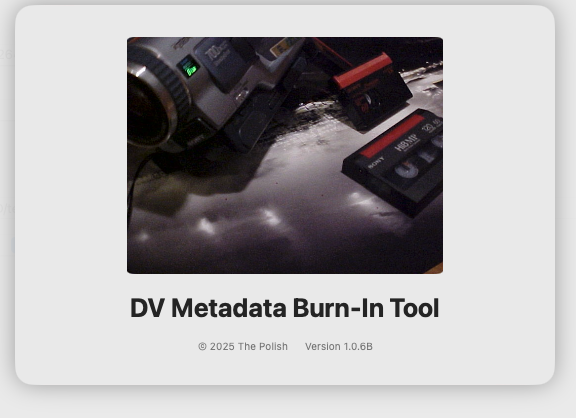
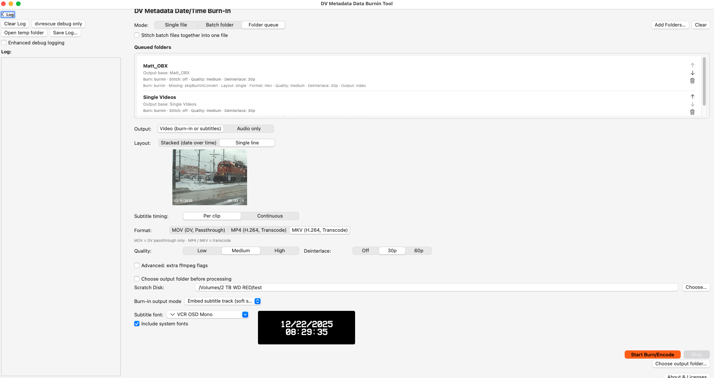
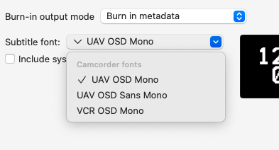
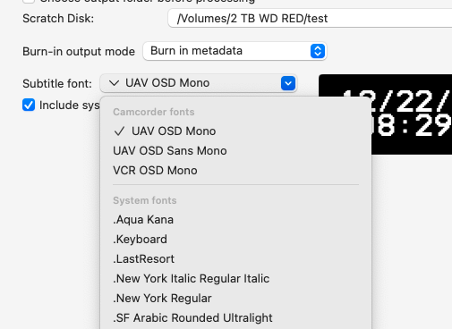

# DVMetaDataBurnIn

**DVMetaDataBurnIn** is a free, open source macOS utility for burning original DV/Digital8 camcorder date/time metadata directly into video files. It’s powered by `dvrescue` and `ffmpeg`, which prior to this involved me banging my head running terminal scripts to get the same result. I wanted a beter way for myself outside of apple script. This is my attempt to make DV timestamp burning actually useable for batchwork. 
---

## Known Issues

- File chooser doesn't limit to file types which the program will accept
- Unknown issue if this will this work on m series mac. Was built / works on an intel mac.
- UI could be way better
- Does not work on Windows 98 =(

---


## Features

- Batch or single-file AVI processing including folder queue
- Extracts original camcorder recording date/time from embedded DV metadata  
- Overlay date/time using what I feel are camcorder-style fonts   
- Export to MOV (original quality) or MP4 (H.264) but trying to keep it as close to "DV visual style" as possible (low compression) 
- Containerize as MP4 in MKV with Subtittles (ASS format) so you can burn in or have the option to output with a turn on/off time and date option
- No command-line required — simple macOS UI (thank god) 
- Built in options to deinerlace

---

## Features Roadmap (ideas)
- Additional layouts for how the camcorder fonts are burned in
    - Maybe a gallery, maybe a preview function idk
- Visual guide improvement (overlay with font instead of static image with prerendered default font)
- Hide better handling of debug options
- Improve debug logs 
- Further scratch/artifact UI improvements (per-run isolation is implemented; see development notes)
- Organize UI better
- Custom FFMPEG args instructions
- Better file browsing handling 
- Progress bar
- Auto chose batch or single file based on input field (.avi = single file, open folder = batch process)
- Presets as an easier way to select options

---
## Screenshots
### Splash Screen


### Main Window


### Main Window (Alternate View)


### Camcorder Only Overview


### Font Picker



---

## Usage

1. **Download** the app  
2. **Launch** it.  
2a. Tell apple you don't care about security becuase you got this from the internet.'
3. **Select** a file or an entire folder of DV/Digital8 clips.  
4. Pick your **layout** and **output format**.  
5. Hit **Run Burn-In** and let it cook.

---

## Requirements

Nothing external.  
`ffmpeg` and `dvrescue` are bundled in the app bundle according to their respective licenses.  
Full license texts are in:  
`Resources/licenses/`

---

## Building and developing

Open `DVMetaDataBurnIn.xcodeproj` in **full Xcode** and build the `DVMetaDataBurnIn` scheme. Command Line Tools alone cannot build the app.

You can also open this same folder in VS Code. Git history and branches belong to the folder, so both editors use the same repository. The included `.vscode/tasks.json` provides tool checks, automated tests, the native Xcode build, and an action to open Xcode. No new Git repository or application architecture is needed.

```sh
zsh Resources/scripts/dev/check_environment.zsh
zsh Resources/scripts/dev/test_all.zsh
zsh Resources/scripts/dev/xcodebuild.zsh -project DVMetaDataBurnIn.xcodeproj -scheme DVMetaDataBurnIn \
  -configuration Debug -derivedDataPath .build/Xcode15DerivedData CODE_SIGNING_ALLOWED=NO build
```

See [development instructions](DEV.md), [test coverage](docs/DEV_TESTS.md), and the [1.0.7 maintenance status](docs/MAINTENANCE_1.0.7.md). Version 1.0.7 passed native Debug and Release builds using Xcode 15.4 on Intel macOS. The build task can use this Mac's Xcode at `/Volumes/1 TB Storage/xcode-15.4/Xcode.app` without changing the system developer selection. Real-footage and GUI acceptance remain separate checks.

Each processing run now uses its own scratch workspace. Defaults live under `~/Library/Logs/DVMeta/run.XXXXXXXX/`; a configured scratch folder uses `<scratch>/DVMetaDataBurnIn/run.XXXXXXXX/`. Temporary subprocess files are removed at handled exit. Diagnostic artifacts are retained by default; existing cleanup controls apply once after the whole job. The GUI's **Open temp folder** opens its latest available run location. Final export locations and filenames retain their existing conventions.

Subtitle tails use a source-frame boundary derived from media duration, with a numbered-frame fallback when duration is unavailable. ASS timing has 10 ms precision. Timestamp styling and encoding defaults are retained. Synthetic tests cover these changes; real-footage and GUI acceptance remain necessary.

Bundled tools:
- FFmpeg (LGPL/GPL)  
- dvrescue (BSD-3-Clause)

---

## Credits

- App & UI: ThePolish (very vibe coded)  

- **UAV OSD Font** by Nicholas Kruse  
  - Free for personal and commercial use  
  - https://www.dafont.com/uav-osd.font  
  - https://nicholaskruse.com/work/uavosd  

- **VCR OSD Mono** by Riciery Leal (mrmanet)  
  - Free for personal and commercial use per author comments  
  - https://www.dafont.com/font-comment.php?file=vcr_osd_mono  

- **FFmpeg** — https://ffmpeg.org/  
- **dvrescue** — https://mediaarea.net/DVRescue  

---

## License

MIT License (see [LICENSE](LICENSE))
